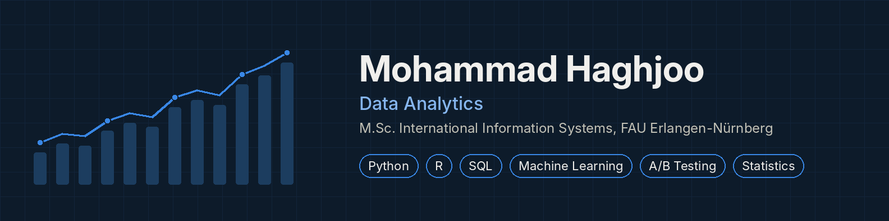

# Mohammad Haghjoo

🎓 Master's student in International Information Systems at FAU Erlangen-Nürnberg  
📍 Nürnberg, Germany  
🔎 Looking for a **working student position (Werkstudent) in data analytics or data science**, from December 2026, up to 20 hours per week

I bring five years of professional experience with PostgreSQL databases, SQL
reporting and data integration, an MBA that grounds the analysis in business
questions, and current project work in Python and R covering data cleaning,
statistical analysis, A/B testing and machine learning.

🌐 [Portfolio](https://mhmmdhaghjoo.github.io) · 📄 [CV (PDF)](Mohammad_Haghjoo_CV.pdf) · 💼 [LinkedIn](https://www.linkedin.com/in/mohammad-haghjoo-b241823b0)

## 🧭 How I work

- **Business question first.** Each project starts from a decision someone has to make and ends in a report that leads with findings.
- **Data quality before models.** Validation checks, reconciliation tests and documented cleaning rules come before any analysis.
- **AI as a draft to be audited.** I use AI coding assistants and LLMs, and I treat their output as something to check: tests, out-of-sample evaluation and fairness audits decide what stays.

## 📊 Projects

Five end-to-end projects. Three look at an online shop from different
angles (data warehouse, predictive model, A/B test in R); one measures
delivery performance on real marketplace data; one is a people analytics
study on a public practice HR dataset.

| Project | What it shows | Stack |
|---|---|---|
| [Employee Turnover Analytics](https://github.com/mhmmdhaghjoo/employee-turnover-analytics) | A public practice HR dataset covering ten years (likely simulated): turnover rates, survival analysis, resignation-risk models tested on unseen years, and a fairness audit, delivered as a management report | pandas, scikit-learn |
| [Checkout A/B Test (R)](https://github.com/mhmmdhaghjoo/checkout-ab-test-r) | Should the shop switch to a one-page checkout? Power analysis, sample ratio check, frequentist and Bayesian estimates, segment effects and a peeking simulation, ending in a rollout recommendation in euros | R, tidyverse, ggplot2, rstanarm, R Markdown |
| [Online Retail SQL Warehouse](https://github.com/mhmmdhaghjoo/online-retail-sql-warehouse) | Raw exports to a tested star schema, then cohort retention, RFM segments and promotion analysis in SQL | PostgreSQL, Python |
| [Customer Churn ML Pipeline](https://github.com/mhmmdhaghjoo/customer-churn-ml-pipeline) | Churn prediction as an installable, tested package with leakage-safe snapshots and an out-of-time evaluation | pandas, scikit-learn, SciPy |
| [Delivery Performance Analytics](https://github.com/mhmmdhaghjoo/delivery-performance-analytics) | Is the delivery promise kept? 96,000 real marketplace orders: on-time rate by state and route, review impact of late delivery and promise calibration; Power BI dashboard in progress | pandas, pytest |

## 🛠️ Skills

- **Programming:** Python (pandas, NumPy, SciPy, scikit-learn), R (tidyverse, ggplot2, rstanarm, R Markdown), SQL
- **Databases:** PostgreSQL; data modelling, star schema, indexing, ETL, data-quality checks
- **Data analysis and statistics:** data cleaning, hypothesis testing, A/B testing and experiment design, regression (including Bayesian), cohort and RFM analysis, survival analysis
- **Machine learning:** regression, classification, clustering, out-of-time model evaluation, fairness audits
- **Visualisation and reporting:** Matplotlib, Seaborn, Plotly, ggplot2, R Markdown, SQL reporting
- **Software engineering:** Git, GitHub Actions, pytest, testthat, linting (ruff, lintr), type hints, packaging

## 💼 Experience and education

- Information Systems Specialist (Databases, Reporting and Data Integration), Shiraz Petrochemical Co., Tehran, Iran, 2020 to 2025
- Information Technology Specialist (Database Administration and Reporting), Tankerranan Petroleum Transport Company, Rafsanjan, Iran, 2014 to 2020
- M.Sc. International Information Systems, FAU Erlangen-Nürnberg, Nürnberg, Germany, since 2025
- MBA, Strategic Management, Allameh Tabataba'i University, Tehran, Iran, 2021 to 2024
- B.Sc. Computer Engineering (Software Engineering), Islamic Azad University, Central Tehran Branch, Tehran, Iran, 2013 to 2020

## 🌍 Languages

Persian (native) · English (C1) · German (A2) · Turkish (intermediate)

## 📫 Contact

[Portfolio](https://mhmmdhaghjoo.github.io) · [LinkedIn](https://www.linkedin.com/in/mohammad-haghjoo-b241823b0) · [CV (PDF)](Mohammad_Haghjoo_CV.pdf)
